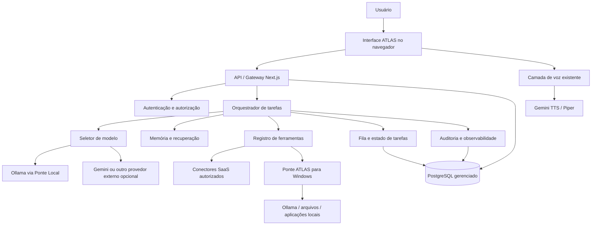
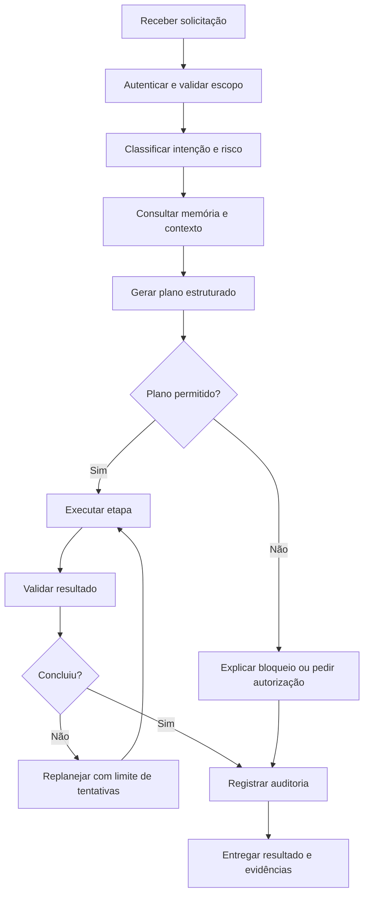

# ATLAS JARVIS — Arquitetura Técnica e Plano de Implementação

**Status:** arquitetura aprovada para orientar implementação  
**Versão:** 1.0  
**Data:** 15/11/2026  
**Repositório:** `enatneuroeducacao-glitch/ATLAS`

## 1. Decisões de produto

As decisões confirmadas para esta evolução são:

- **Arquitetura híbrida:** Ollama e recursos locais como caminho prioritário para tarefas compatíveis; provedores externos opcionais para capacidade adicional.
- **Autonomia alta, com limites:** o agente pode planejar e executar fluxos permitidos, mas ações críticas, destrutivas, financeiras, de publicação ou que exponham dados exigem aprovação explícita.
- **Interface principal no navegador:** evolução da interface Next.js existente. Não criar um segundo frontend independente.
- **Preservação:** manter chat, histórico, conhecimento ENAT, voz/TTS atual, Estúdio de Áudio, Estúdio de Vídeo, renderização offline e salvamento automático dos roteiros.

O nome JARVIS descreve a experiência pretendida; ATLAS continua sendo a identidade do produto.

## 2. Diagnóstico do repositório (baseline observado)

A análise do branch `main` identificou:

- Next.js 15, React 19 e TypeScript.
- Interface principal em `app/page.tsx`.
- Rotas atuais `POST /api/chat`, `POST /api/tts` e `GET /api/health`.
- Chat baseado em Gemini, com instruções e base de conhecimento ENAT.
- TTS baseado em Gemini, com fallback Piper configurável.
- Entrada de voz via Web Speech API do navegador.
- Conversas armazenadas no `localStorage` do navegador (até 100 conversas; histórico limitado por conversa).
- Estúdios de áudio e vídeo em componentes próprios.
- Estúdio de vídeo com renderização offline Mediabunny/WebCodecs, modo gerar/baixar e modo pré-visualizar.
- Roteiro do Estúdio de Vídeo com salvamento automático no armazenamento local do navegador.
- Não foi identificado no baseline: provedor Ollama, banco de dados persistente do ATLAS, autenticação de usuário, registro de ferramentas executáveis, runtime de agentes, ponte local com Windows ou trilha central de auditoria.

**Consequência:** o ATLAS atual é uma aplicação web de assistente especializado; ainda não é um agente operacional. A evolução deve adicionar essas capacidades por módulos, sem substituir as rotas e componentes existentes de uma só vez.

## 3. Arquitetura-alvo

### 3.1 Visão de alto nível



### 3.2 Camadas e responsabilidades

1. **Experiência web:** chat, voz, histórico, estado das tarefas, aprovações, configurações, memória e ferramentas. A navegação e o design atuais serão evoluídos incrementalmente.
2. **Gateway/API:** valida sessão, entrada, limites, escopos, origem e rate limits. Nenhuma chave de provedor ou credencial de integração chega ao navegador.
3. **Núcleo cognitivo:** classifica intenção, seleciona modelo, decide se responde ou planeja, solicita contexto e produz plano estruturado.
4. **Orquestrador:** executa planos como máquinas de estado, acompanha passos, tentativas, prazos, cancelamento e resultados.
5. **Registro de ferramentas:** catálogo tipado de ações com schema de entrada/saída, escopos, nível de risco, timeout, idempotência e política de aprovação.
6. **Memória:** conversas, resumos, preferências, fatos aprovados pelo usuário, documentos e recuperação contextual.
7. **Ponte local:** agente complementar instalado no Windows, com conexão de saída autenticada para o serviço e acesso apenas a capacidades locais explicitamente habilitadas.
8. **Provedores:** Ollama local e modelos externos opcionais atrás de uma interface comum.
9. **Voz:** TTS e reconhecimento desacoplados do raciocínio. O pipeline atual de voz será preservado como baseline.
10. **Observabilidade e segurança:** logs estruturados, auditoria, métricas, rastreio de execução e alertas sem registrar segredos ou conteúdo sensível desnecessário.

## 4. Estratégia híbrida de modelos

### 4.1 Contrato único de provedor

Criar uma interface interna `LLMProvider` com operações de geração, streaming quando suportado, identificação do modelo, capacidades, timeout e normalização de erros.

Implementações planejadas:

- `OllamaProvider`: acesso ao Ollama somente através da Ponte Local autenticada; nunca presumir que o serviço Ollama do computador do usuário esteja acessível a partir do Render.
- `GeminiProvider`: encapsular a integração Gemini existente, mantendo os nomes de modelos e variáveis atuais durante a migração.
- Futuros provedores: adicionados sem alterar o orquestrador ou a interface.

### 4.2 Política de roteamento

- Local primeiro para tarefas privadas, rotineiras ou quando a ponte estiver conectada e o modelo local tiver capacidade suficiente.
- Provedor externo somente quando habilitado pelo usuário/política e quando houver benefício claro de qualidade, contexto ou disponibilidade.
- Nunca enviar arquivos, memória privada ou dados sensíveis a um provedor externo sem política explícita e indicação ao usuário.
- Se o modelo local estiver indisponível, informar a condição e aplicar fallback externo somente se autorizado; caso contrário, oferecer resposta limitada ou aguardar reconexão.
- Registrar provedor/modelo utilizado, latência e motivo do roteamento, sem registrar chaves ou prompts sensíveis em texto puro.

### 4.3 Voz não é o roteador cognitivo

O TTS atual não deve ser trocado durante a implementação do núcleo JARVIS. Preservar endpoint `/api/tts`, texto de orientação vocal, voz configurada, Piper fallback, limites e controles do player. Uma futura mudança de voz exige solicitação e homologação separadas.

## 5. Ponte local ATLAS para Windows

### 5.1 Por que é necessária

O serviço publicado no Render não pode acessar diretamente arquivos, processos, dispositivos ou Ollama em `localhost` no computador do usuário. A ponte local resolve essa separação sem abrir portas de entrada na rede doméstica.

### 5.2 Responsabilidades

- Iniciar como aplicação/serviço local sob o usuário do Windows.
- Abrir conexão de saída autenticada com o backend ATLAS usando TLS e credencial de dispositivo rotacionável.
- Fazer pareamento explícito entre conta e dispositivo.
- Disponibilizar Ollama local, informações de saúde e ferramentas locais autorizadas.
- Receber somente comandos assinados, validados e dentro dos escopos concedidos.
- Mostrar estado de conexão e permitir desconectar/revogar o dispositivo.
- Não oferecer shell arbitrário, execução irrestrita de PowerShell, leitura geral de disco ou acesso remoto invisível.

### 5.3 Ferramentas locais por níveis

- **Leitura de baixo risco:** status do Ollama, listar arquivos de uma pasta escolhida, ler arquivo explicitamente selecionado, consultar versão de aplicativo.
- **Escrita reversível:** criar rascunho, gerar arquivo em pasta autorizada, preparar alteração em branch.
- **Ação crítica:** executar comandos, apagar/substituir arquivos, instalar software, alterar configurações, publicar ou tocar em dados de produção. Sempre exigir aprovação clara, escopo, resumo do impacto e registro.

A ponte deve operar com privilégio mínimo, diretórios permitidos, lista de executáveis permitidos, limites de tamanho, timeout, proteção contra path traversal e bloqueio por padrão.

## 6. Memória e persistência

### 6.1 Fonte persistente

Adicionar PostgreSQL gerenciado como fonte persistente do ATLAS. A escolha inicial recomendada é PostgreSQL compatível com Neon, evitando depender de memória em processo do Render.

Modelo lógico inicial:

- `users`: identidade e preferências de conta.
- `devices`: dispositivos pareados, status e última conexão.
- `conversations`: conversas e metadados.
- `messages`: mensagens com ordem, papel, timestamps e referências.
- `memory_items`: fatos/preferências aprovados, origem, confiança, validade e escopo.
- `documents`: arquivos, metadados, permissões e estado de indexação.
- `tasks`: tarefas do agente, estado, prioridade, prazo e proprietário.
- `task_steps`: etapas, entradas/saídas resumidas, tentativas e estado.
- `tool_runs`: invocações, ferramenta, escopo, risco, resultado e duração.
- `approvals`: pedido, decisão, usuário aprovador, validade e ação autorizada.
- `audit_events`: eventos de segurança e alterações relevantes.

### 6.2 Migração sem perda

- Manter a leitura dos dados existentes no `localStorage`.
- Criar processo de importação idempotente das conversas locais para a conta autenticada.
- Não apagar chaves antigas automaticamente.
- Preservar o histórico ENAT e as conversas já existentes.
- Manter salvamento local temporário como cache/offline, sincronizando com o servidor quando autenticado.
- O roteiro do Estúdio de Vídeo permanece com seu salvamento local atual; a sincronização na nuvem será fase posterior e não deve remover o fallback local.

### 6.3 Memória sob controle do usuário

Distinguir histórico bruto, resumo de conversa e memória durável. Só promover fatos pessoais para memória durável por política transparente e com controles de revisão, edição e exclusão. Aplicar retenção, exportação e exclusão por conta.

Busca semântica com pgvector pode ser adicionada depois da persistência relacional estar estável; não é requisito para a primeira entrega.

## 7. Agentes, planejamento e execução

### 7.1 Fluxo de execução



### 7.2 Estado da tarefa

Estados mínimos: `queued`, `planning`, `awaiting_approval`, `running`, `paused`, `completed`, `failed`, `cancelled`, `expired`.

Cada tarefa terá:
- ID e usuário proprietário.
- Objetivo, plano e ferramentas autorizadas.
- Limite de etapas, duração, tentativas e custo.
- Idempotency key para evitar execução duplicada.
- Estado atual, progresso e resultado verificável.
- Registro de aprovações e auditoria.
- Botões para pausar, continuar, cancelar e revisar.

### 7.3 Níveis de autonomia

- **A0 — Consultar:** responder e pesquisar sem alterar sistemas.
- **A1 — Preparar:** criar rascunhos, planos e mudanças propostas.
- **A2 — Executar reversível:** executar ações permitidas e recuperáveis dentro de escopos previamente concedidos.
- **A3 — Ação crítica:** exige aprovação pontual; inclui publicação em produção, exclusões, alterações financeiras, mudanças de permissões, migrações destrutivas e comandos privilegiados.

A preferência de autonomia alta não elimina as aprovações A3. O usuário pode conceder previamente escopos A1/A2 específicos, revogáveis e auditáveis.

## 8. Registro de ferramentas e integrações

Cada integração será um adaptador isolado, não uma chamada improvisada pelo modelo. Cada ferramenta declara:

- identificador e versão;
- descrição curta e casos de uso;
- schema JSON de entrada e saída;
- permissões e escopos requeridos;
- classificação de risco;
- necessidade de aprovação;
- timeout, retry e idempotência;
- política de dados e auditoria.

### Ordem sugerida de conectores

1. **Ollama local:** modelo e estado do runtime.
2. **GitHub:** leitura de repositório, issues, PRs, logs; criação de branch/PR; alterações sempre em branch e com CI.
3. **Render:** status, deploys e logs de serviços; publicação/rollback sujeitos a aprovação.
4. **Arquivos locais:** pastas explicitamente autorizadas e arquivos escolhidos pelo usuário.
5. **Navegador:** navegação assistida e automações em domínios permitidos, com confirmação antes de submissões externas.
6. **PostgreSQL/Neon:** consultas com usuário de menor privilégio; alterações e migrações sob aprovação.
7. **WhatsApp Business:** somente API oficial, templates e permissões aprovadas; não automatizar sessão pessoal por scraping.

Não declarar integração ativa até credenciais, conexão, escopos e testes de ponta a ponta serem comprovados.

## 9. API interna proposta

As rotas existentes devem continuar compatíveis:

- `POST /api/chat`: preservar contrato atual enquanto o adaptador de modelos é introduzido.
- `POST /api/tts`: preservar pipeline vocal.
- `GET /api/health`: ampliar status sem revelar segredos.

Novas rotas planejadas:

- `POST /api/agent/tasks`: criar tarefa/plano.
- `GET /api/agent/tasks/:id`: consultar estado e progresso.
- `POST /api/agent/tasks/:id/approve`: aprovar uma ação específica.
- `POST /api/agent/tasks/:id/pause`: pausar.
- `POST /api/agent/tasks/:id/resume`: retomar.
- `POST /api/agent/tasks/:id/cancel`: cancelar.
- `GET /api/agent/tools`: listar ferramentas disponíveis para o usuário.
- `GET /api/devices`: listar dispositivos pareados.
- `POST /api/devices/pair`: iniciar pareamento.
- `DELETE /api/devices/:id`: revogar dispositivo.
- `GET /api/memory`, `PATCH /api/memory/:id`, `DELETE /api/memory/:id`: gerenciar memória própria.
- `GET /api/audit`: consultar eventos autorizados.

A entrega poderá usar Server-Sent Events para progresso do navegador; WebSocket fica reservado à conexão persistente entre o serviço e a Ponte Local.

## 10. Segurança obrigatória

- Autenticação antes de memória, dispositivos, tarefas ou ferramentas pessoais.
- Autorização server-side por usuário, recurso e escopo; nunca confiar em permissões enviadas pelo navegador.
- Segredos apenas em variáveis de ambiente/secret manager.
- TLS em todas as conexões externas e tokens curtos/rotacionáveis para dispositivos.
- Proteção CSRF/origin, rate limiting distribuído, validação de payload e limites de tamanho.
- Separação entre conteúdo de usuário/documento e instruções do agente; conteúdo recuperado é dado não confiável e não pode conceder novas permissões.
- Tool allowlist por usuário e por dispositivo.
- Aprovação vinculada ao hash da ação exata, com expiração; qualquer alteração do payload invalida a aprovação.
- Logs de auditoria append-only, com redaction de tokens, chaves, dados pessoais e conteúdo sensível.
- Limites de execução, orçamento, concorrência e tempo.
- Cancelamento efetivo e proteção contra repetição.
- Backups, política de retenção, exportação e exclusão de dados.
- Testes de prompt injection, escalada de privilégio, SSRF, path traversal, replay, CSRF, abuso de ferramentas e isolamento entre usuários.

## 11. Experiência da interface web

Evoluir a aplicação atual com uma área de trabalho JARVIS, mantendo navegação e ferramentas atuais:

- **Painel central:** estado do ATLAS, provedor ativo, dispositivo local conectado, memória e tarefas em andamento.
- **Chat multimodal:** texto e voz com continuidade da conversa.
- **Comando de voz:** ativar/desativar, indicador de escuta e interrupção de fala.
- **Central de tarefas:** plano, etapas, progresso, logs resumidos, pausa, retomada e cancelamento.
- **Central de aprovações:** ação, impacto, recursos, escopo, validade e botões de aprovar/rejeitar.
- **Memória:** pesquisar, revisar, editar, exportar e excluir memórias.
- **Dispositivos:** parear, status, permissões e revogação.
- **Integrações:** conectar, testar, escopos e desconectar.
- **Ferramentas ENAT atuais:** Planejar aula, Simulado, Legislação, Estúdio de Áudio, Estúdio de Vídeo e Análise de Risco.

A interface deve continuar responsiva e acessível. Não remover o layout atual antes da homologação do novo painel.

## 12. Plano de implementação por fases

### Fase 0 — Congelamento funcional e baseline

- Registrar versão e comportamento atuais.
- Criar testes de fumaça para chat, TTS, entrada de voz, histórico, áudio e vídeo.
- Confirmar variáveis e serviços de produção sem expor segredos.
- Estabelecer política de branches, PRs e CI.
- **Saída:** baseline reproduzível e plano de rollback.

### Fase 1 — Fundação de segurança e persistência

- Implementar autenticação e sessões.
- Provisionar PostgreSQL gerenciado e migrações versionadas.
- Criar esquema de usuários, conversas, mensagens, dispositivos e auditoria.
- Migrar histórico do localStorage de modo idempotente.
- Manter compatibilidade com sessões sem sincronização durante transição controlada.
- **Saída:** conta autenticada, histórico persistente e isolamento entre usuários.

### Fase 2 — Camada de provedores híbridos

- Definir `LLMProvider` e testes de contrato.
- Encapsular Gemini sem alterar prompts, modelo configurado ou comportamento atual.
- Criar `OllamaProvider` atrás da Ponte Local.
- Criar política de roteamento, fallback e indicador de provedor.
- **Saída:** alternância controlada entre local e externo, com telemetria.

### Fase 3 — Ponte Local Windows

- Criar serviço/companheiro local com instalador e atualização assinada.
- Implementar pareamento e canal de saída TLS.
- Conectar Ollama e expor apenas ferramentas locais de leitura permitidas.
- Adicionar status de dispositivo, revogação e logs.
- **Saída:** navegador hospedado conversa com o Ollama local sem expor portas de entrada.

### Fase 4 — Memória contextual

- Persistir conversas e resumos.
- Implementar memória explícita, aprovada e editável.
- Criar busca textual e depois semântica/pgvector.
- Adicionar retenção, exportação e exclusão.
- **Saída:** continuidade entre sessões, dispositivos e atualizações.

### Fase 5 — Orquestrador e agentes

- Implementar máquina de estados e fila persistente.
- Criar planner com plano JSON validado.
- Implementar registry de ferramentas e política de risco.
- Adicionar aprovações, pausa, retomada, cancelamento, idempotência e auditoria.
- Iniciar com ferramentas somente de leitura.
- **Saída:** tarefas multi-etapas verificáveis, sem execução arbitrária.

### Fase 6 — Conectores operacionais

- GitHub primeiro: leitura, diagnóstico, branch e PR; CI obrigatório.
- Render depois: status e logs; deploy/rollback aprovados.
- Arquivos locais e navegador com escopo restrito.
- Neon/PostgreSQL e outros conectores conforme necessidade.
- **Saída:** integrações testadas ponta a ponta e documentadas.

### Fase 7 — Experiência JARVIS e proatividade

- Painel de tarefas e aprovações.
- Conversação por voz com interrupção e continuidade.
- Alertas e automações programadas com opt-in.
- Observabilidade, métricas e ajustes de UX.
- **Saída:** experiência integrada e pronta para homologação de uso real.

## 13. Critérios de aceite e não regressão

A evolução só será considerada homologada quando:

1. Chat atual responde com a mesma base ENAT e sem mensagens inválidas.
2. Voz TTS mantém timbre, voz, parâmetros e fallback atuais.
3. Reconhecimento de voz permanece funcional nos navegadores suportados.
4. Histórico e roteiros existentes não são perdidos durante a migração.
5. Estúdio de áudio e vídeo continuam acessíveis e funcionais.
6. Os dois modos de vídeo continuam gerando arquivo com áudio sincronizado.
7. Um usuário não consegue acessar conversas, memória, dispositivos ou tarefas de outro.
8. Ações críticas não executam sem aprovação válida.
9. Tarefa pode ser pausada/cancelada e não se duplica após retry.
10. Ponte local não aceita conexões ou comandos não autenticados.
11. Ausência de Ollama não derruba o chat: aplica fallback permitido ou informa indisponibilidade.
12. Ausência de Gemini não derruba a experiência quando Ollama estiver pareado e autorizado.
13. Nenhuma chave, token ou segredo aparece em bundle, logs ou respostas HTTP.
14. Build, lint, testes e deploy de homologação passam antes de produção.

## 14. Estratégia de entrega e rollback

- Uma fase por branch/PR; evitar PR monolítico.
- CI obrigatório: lint, TypeScript, build, testes unitários, testes de integração e testes de segurança aplicáveis.
- Deploy primeiro em serviço de homologação separado.
- Migrações aditivas e compatíveis; evitar remoções de colunas/rotas até o fim da transição.
- Feature flags para autenticação obrigatória, roteamento local, memória, agentes e conectores.
- Monitorar erros, latência, custo, falhas de TTS e sucesso das tarefas.
- Rollback de aplicação independente do rollback de dados; migrações destrutivas ficam proibidas sem plano validado.

## 15. Estrutura de diretórios-alvo

A estrutura abaixo é proposta; criar gradualmente, sem mover arquivos existentes de uma só vez:

```text
app/
  api/
    agent/tasks/
    agent/tools/
    approvals/
    auth/
    devices/
    memory/
    audit/
components/
  jarvis/
    CommandCenter.tsx
    TaskBoard.tsx
    ApprovalCenter.tsx
    MemoryPanel.tsx
    DevicePanel.tsx
lib/
  ai/
    providers/
      provider.ts
      gemini.ts
      ollama.ts
    routing/
  agent/
    planner/
    orchestrator/
    policies/
    tools/
  memory/
  auth/
  db/
  audit/
bridge/
  windows/
    src/
    installer/
docs/
  ATLAS-JARVIS-ARQUITETURA.md
```

## 16. Variáveis futuras (não configurar antes de cada fase)

- `DATABASE_URL`: conexão PostgreSQL, somente no servidor.
- `AUTH_SECRET`: segredo de sessão.
- `OLLAMA_MODEL`: modelo local padrão.
- `ATLAS_BRIDGE_TOKEN_SECRET`: assinatura/validação de credenciais de dispositivos.
- `GEMINI_API_KEY`, `GEMINI_MODEL`, `GEMINI_TTS_MODEL`, `GEMINI_TTS_VOICE`: manter as atuais.
- `PIPER_TTS_URL`, `PIPER_API_TOKEN`: manter fallback atual.

Os nomes são proposta de configuração; não criar valores falsos nem inserir segredos no Git. Cada variável será adicionada apenas quando a respectiva funcionalidade estiver implementada e testada.

## 17. Fora do escopo da primeira entrega

- Controle irrestrito do computador ou shell remoto genérico.
- Acesso silencioso a arquivos, câmera, microfone ou mensagens.
- Execução automática de pagamentos, compras, exclusões ou publicação em produção.
- Treinamento de modelo próprio do zero.
- Substituição do Gemini TTS/Piper antes de testes de voz aprovados.
- Migração imediata de toda a interface ou remoção das ferramentas ENAT existentes.

## 18. Ordem imediata de trabalho

1. Aprovar este documento como referência arquitetural.
2. Congelar e testar baseline funcional.
3. Definir ambiente de homologação e estratégia de autenticação.
4. Implementar persistência PostgreSQL e migração segura de conversas.
5. Criar abstração de provedor e integrar Ollama via ponte local.
6. Só então introduzir planner, registry de ferramentas e execução de tarefas.

**Regra de engenharia:** primeiro segurança, persistência e compatibilidade; depois autonomia. O ATLAS deve ganhar capacidades sem perder aquilo que já funciona.
